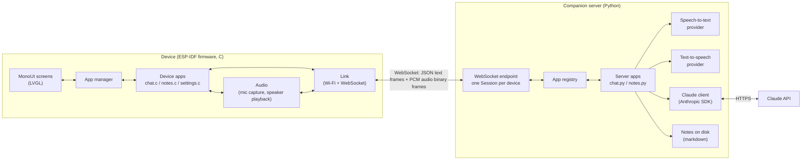

# Architecture

This document explains how the pieces of the assistant fit together. It is
written for someone who wants to understand the system at a high level before
reading code.

## The one-paragraph version

The device is a thin client. It owns the screen, the touch panel, the
microphone, the speaker and the battery. It does not talk to Claude directly.
Instead it keeps one WebSocket connection open to a small Python program called
the **companion server**, which runs on a laptop, a home server or a cloud
machine. The server does everything that needs a real computer or an API key:
speech-to-text, the Claude conversation, text-to-speech, and note storage.
Every feature is an **app**, and an app has two halves: a small screen on the
device and a handler on the server. Adding a feature means adding one C file on
the device and one Python file on the server.

## Why a companion server instead of calling Claude from the device

| Concern | Device-only design | Companion server design (chosen) |
| --- | --- | --- |
| Speech-to-text and text-to-speech | Not available on the microcontroller; the device would need to call two or three cloud services itself, each with its own Transport Layer Security (TLS) session and key | One connection, one place to swap providers |
| API keys | Stored in flash on a device you carry around | Stay on the server |
| Adding features | Every feature is firmware, so every change is a reflash | Most logic is Python; the device only needs a screen |
| Memory | The ESP32-S3 has about 512 kB of internal random-access memory (RAM) plus 8 MB of slower pseudo-static RAM (PSRAM); several TLS sessions plus audio buffers plus a graphics library is tight | The device holds one TLS session and audio buffers |
| Latency | Lower in theory | Adds one hop on the local network, a few milliseconds |

The cost is that the device needs the server to be reachable. On a home
network that is a laptop or a Raspberry Pi; away from home it is a small cloud
virtual machine or a tunnel to the home server.

## The hardware

The board is the Waveshare ESP32-S3-Touch-AMOLED-1.8. What the firmware uses:

| Part | Chip | Bus | Role in this project |
| --- | --- | --- | --- |
| Microcontroller | ESP32-S3R8, dual core, 240 MHz, 8 MB PSRAM, 16 MB flash | | Runs the firmware, Wi-Fi, WebSocket |
| Display | 1.8 inch AMOLED, 368 by 448 pixels, SH8601 (revision 1) or CO5300 (revision 2) controller | Quad Serial Peripheral Interface (QSPI) | The MonoUI style screen |
| Touch | FT3168 (revision 1) or CST820 (revision 2) | Inter-Integrated Circuit (I2C) | Swipe and tap navigation |
| Audio codec | ES8311, with onboard microphone and speaker amplifier | Inter-IC Sound (I2S) for samples, I2C for control | Microphone capture and speech playback |
| Power management | AXP2101 | I2C | Battery percentage, charging state |
| Real-time clock | PCF85063 | I2C | Not used yet; the device gets time from the server |
| Inertial unit | QMI8658 | I2C | Not used yet; candidate for "raise to wake" |
| Buttons | BOOT (GPIO 0) and PWR (through the AXP2101) | | BOOT is the "back" key |

The Waveshare board support package (BSP), published as the managed component
`waveshare/esp32_s3_touch_amoled_1_8`, already knows the pin map, probes which
touch controller is fitted, and starts the Light and Versatile Graphics Library
(LVGL). The firmware builds on it rather than re-implementing drivers.

## The big picture



## How a request flows: "ask Claude something"

1. The user swipes to the **Chat** tile and taps it. The device app manager
   calls the chat app's `on_enter`, which draws the chat screen and sends
   `{"type": "app.open", "app": "chat"}` to the server. The server creates a
   `ChatApp` instance for this session.
2. The user taps the screen. The device sends `{"type": "chat.ptt_start"}` and
   starts the microphone task. Every 20 milliseconds the task reads 320
   samples (16 kHz, 16-bit, mono) from the codec and sends them as one binary
   WebSocket frame.
3. The server's `ChatApp.on_audio` appends the bytes to a buffer.
4. The user taps again. The device sends `{"type": "chat.ptt_stop"}` and stops
   the microphone.
5. The server runs the buffer through the speech-to-text provider, sends
   `{"type": "chat.transcript", "text": "..."}` so the device can show what it
   heard, then streams the Claude reply. Each text delta is sent as
   `{"type": "chat.delta", "text": "..."}` and the device appends it to the
   reply label as it arrives.
6. As sentences complete, the server runs them through the text-to-speech
   provider and sends the audio back as binary frames. The device's playback
   task pulls from a ring buffer and writes to the codec, so speech starts
   before Claude has finished the whole answer.
7. `{"type": "chat.done"}` ends the turn. The conversation history stays on
   the server, so the next question is a follow-up.

## How a request flows: "take notes in a meeting"

1. The user opens **Notes** and taps **New**. The device sends
   `{"type": "notes.start"}` and starts streaming microphone audio exactly as
   in chat, but continuously.
2. The server's `NotesApp` collects audio into windows of about 20 seconds,
   transcribes each window as it closes, and sends each result as
   `{"type": "notes.line", "text": "..."}`. The device shows the last few
   lines and a running timer, so the user can see it is working.
3. The user taps **Stop**. The server joins the transcript, asks Claude for a
   title, a short summary and action items in a fixed JSON shape, writes the
   whole thing to `notes/<timestamp>-<slug>.md`, and sends
   `{"type": "notes.summary", ...}` for the device to display.
4. The notes list on the device is populated by `{"type": "notes.list"}`;
   selecting one asks for `{"type": "notes.get", "id": "..."}`.

## The protocol

Everything goes over one WebSocket. See [PROTOCOL.md](PROTOCOL.md) for the
message list. The rules:

- **Text frames are JSON** with a `type` field. The part before the first dot
  is the app name (`chat`, `notes`) or `app` / `sys` for framework messages.
  Both sides route by that prefix, which is what makes new apps cheap: nothing
  in the framework has to change.
- **Binary frames are audio.** Byte 0 is a format code; code `0x01` is
  16-bit little-endian signed PCM, mono, 16 kHz. The rest of the frame is
  samples. The same frame format is used in both directions.
- The device sends `sys.hello` on connect; the server answers `sys.hello_ack`
  with the list of apps it knows about. The device checks that each of its
  apps has a server counterpart and greys out the ones that do not.

## Inside the firmware

```
firmware/
  main/
    main.c                 boot: board, link, app manager, launcher
    board/                 thin wrappers around the BSP (audio, battery, button)
    link/                  Wi-Fi station + WebSocket client + JSON dispatch
    audio/                 capture task, playback task, ring buffer
    ui/                    MonoUI theme and widgets (tiles, list, status bar)
    apps/                  one file per app + the registry
      app.h                the app_t interface
      app_registry.c       the list of apps shown on the launcher
      app_chat.c
      app_notes.c
      app_settings.c
    assets/                generated icon bitmaps
  tools/gen_icons.py       converts ASCII-art icons into C bitmaps
```

### Tasks (threads) and how they talk

| Task | Owner | What it does |
| --- | --- | --- |
| LVGL task | BSP (`esp_lvgl_port`) | Redraws the screen, runs animations, reads touch. All drawing happens here, guarded by `bsp_display_lock` |
| Wi-Fi and WebSocket | ESP-IDF event loop and `esp_websocket_client` | Delivers connection state and incoming frames as events |
| Capture task | `audio/capture.c` | Reads the microphone in 20 millisecond chunks and hands them to the link |
| Playback task | `audio/playback.c` | Drains a ring buffer into the speaker |
| App manager | runs inside the LVGL task | Routes input events and incoming messages to the active app |

Incoming messages arrive on the WebSocket task. The link does not call app
code from there; it copies the JSON into a FreeRTOS queue and the app manager
drains that queue from an LVGL timer. That keeps every app callback on the
LVGL thread, so apps can touch widgets without locking.

### The app interface

```c
typedef struct app {
    const char *id;          // "chat" - also the message prefix
    const char *title;       // shown under the launcher tile
    const lv_image_dsc_t *icon;
    void (*on_enter)(struct app *self, lv_obj_t *parent);
    void (*on_exit)(struct app *self);
    bool (*on_input)(struct app *self, ui_input_t ev);   // tap, swipe, back
    void (*on_message)(struct app *self, const char *type, cJSON *msg);
    void (*on_audio)(struct app *self, const int16_t *pcm, size_t n);
    void (*on_link_state)(struct app *self, bool connected);
} app_t;
```

The app manager keeps a one-level stack: the launcher, or the launcher plus
one app. The BOOT button and a right swipe always mean "back".

### The MonoUI look

MonoUI is a monochrome, high-frame-rate style: black background, white
one-bit graphics, a selection box that slides between rows with an ease-out
curve, a thin scrollbar, and a launcher made of large icons that glide
horizontally with the title under the centred one. The firmware reproduces it
with LVGL animations on a colour panel, drawing only black and white. Black
pixels on an AMOLED panel are off, which also saves battery.

- `ui/mono_theme.c` sets the palette and fonts once.
- `ui/mono_tiles.c` is the launcher strip.
- `ui/mono_list.c` is the animated list used by menus and the notes browser.
- `ui/mono_status.c` is the top bar: link state, battery, clock.

## Inside the server

```
server/
  assistant_server/
    main.py          starts the WebSocket server
    session.py       one per device connection; owns the open app
    protocol.py      message helpers and the binary audio frame codec
    config.py        settings from environment variables
    llm/claude.py    Anthropic SDK wrapper (streaming chat, JSON summaries)
    providers/       speech-to-text and text-to-speech backends
      stt.py         STTProvider interface + implementations
      tts.py         TTSProvider interface + implementations
    apps/
      base.py        App base class and the registry
      chat.py
      notes.py
  tests/             pytest, no network needed
```

A `Session` holds the socket, the device id, and at most one open server app.
When `app.open` arrives it instantiates the registered class; when
`app.close` arrives it tears it down. Messages whose prefix matches the open
app go to `App.on_message`; binary frames go to `App.on_audio`.

Providers are plain classes with one method each. Choosing one is an
environment variable, so swapping Whisper for a local model is a config change,
not a code change.

The Claude client uses the official Anthropic Python SDK with streaming, so
the first words reach the device quickly. Chat uses low effort for fast spoken
answers; note summaries use medium effort and structured JSON output.

## Adding an app

See [ADDING_AN_APP.md](ADDING_AN_APP.md). The short version:

1. Server: subclass `App`, set `name = "timer"`, implement `on_message`, add
   it to the registry.
2. Device: write `apps/app_timer.c` implementing `app_t`, draw an icon in
   `assets/icons/timer.txt`, add the app to `app_registry.c`.
3. Agree on a few message types with the `timer.` prefix.

Nothing else changes.
